<div align="center">


# MatBoard

**Das digitale Whiteboard für Teams – wie Miro, aber selbst gehostet: Ideen sammeln, Workshops moderieren, Pläne zeichnen, alle gleichzeitig.**

Ein App-Container und PostgreSQL. Port **3945**.

</div>

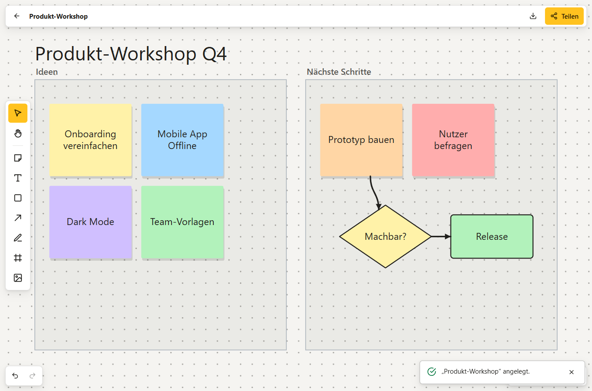

---

## Auf einen Blick

**Die Fläche**
- **Endlose Fläche** mit Zoom und Verschieben – Maus, Trackpad, Stift, zwei Finger auf dem Smartphone; Hintergrund Punkte, Raster, Linien oder leer
- **Haftnotizen**, **Text**, **Formen** (Rechteck, Ellipse, Raute, Dreieck), **Stift**, **Bilder** (auswählen, einfügen, hineinziehen)
- **Verbindungen**: gerade, als Kurve oder im Winkel, mit Pfeilspitzen; sie haften an Formen und folgen ihnen
- **Frames** fassen Dinge zusammen und nehmen ihren Inhalt beim Verschieben mit
- Auswahl per Klick oder Rechteck, **Verschieben, Skalieren, Drehen**, Farben, Schriftgröße, Reihenfolge, Duplizieren, Kopieren und Einfügen, **Rückgängig / Wiederholen**
- **Ausrichtungslinien** beim Verschieben (Alt schaltet sie ab), **Schnell-Verbinden**: die Punkte neben einer Notiz legen eine verbundene Kopie an
- **Sperren** von Objekten (Strg+Umschalt+L) – gesperrt heißt auch für alle anderen gesperrt, der Server setzt es durch
- **Export** als PNG, SVG oder JSON

**Workshops wie in Miro**
- **Vorlagen**: Kanban-Board, Retrospektive, Mindmap, SWOT-Analyse, Wochenplan, Flussdiagramm, Customer Journey – eingefügt, wo man gerade hinschaut
- **Kommentare** als Pins mit Antworten, „erledigt“ und einer Liste aller Kommentare
- **Stempel** 👍 ❤️ ⭐ ✅ 💡 🎉 +1 … zum Abstimmen und Markieren
- **Präsentieren**: Frames nacheinander als Folien, mit Pfeiltasten, im Vollbild
- **Suche** auf dem Board (Strg+F, Enter springt zum nächsten Treffer) und eine **Übersichtskarte** (M)

**Zusammen arbeiten**
- **Live**: Wer ist da, Cursor mit Namen, jede Änderung erscheint sofort bei allen (WebSocket). Gleichzeitige Änderungen am selben Objekt werden Feld für Feld zusammengeführt
- **Folgen**: ein Klick auf einen Avatar, und man sieht, was diese Person sieht; **Alle zu mir holen** bringt alle an die eigene Stelle
- **Teilen** mit Personen, die ein Konto haben – als *Bearbeiter* oder *Betrachter*, auf Wunsch mit E-Mail (MatSMTP) – oder per **Link** zum Ansehen oder Bearbeiten; Gäste nennen nur einen Namen. Ein neuer Link macht den alten ungültig; Rechte gelten sofort, auch für offene Verbindungen
- **Offline**: das zuletzt geladene Board bleibt sichtbar, Änderungen werden auf dem Gerät gesammelt und nach der Wiederverbindung abgeglichen

**Oberfläche**
- **Deutsch und Englisch**, **hell / dunkel** – umschaltbar auch direkt auf dem Board –, Farbschemata (Standard, Papier, hoher Kontrast, OLED)
- **Smartphone**: die Werkzeuge rutschen nach unten, Fenster werden zu Bottom Sheets, 44-px-Ziele; als **PWA** installierbar (Android, iOS, Desktop)
- Kurzbefehle für alle Werkzeuge (V H N T R L P F C S I), Tooltips zeigen sie an; die ganze Liste steht unter *Über*
- **Deine Daten (DSGVO)**: alles als JSON herunterladen und das Konto endgültig löschen
- Design von [MatDesign](https://github.com/Real-TTX/MatDesign) (MatUi). Das erste Konto ist der Administrator

## Screenshots

| Kommentare mit Antworten | Vorlagen |
|---|---|
| 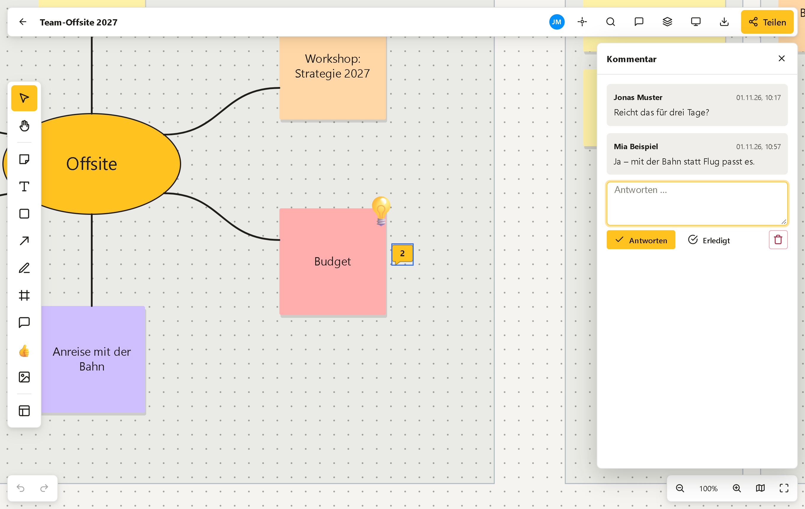 | 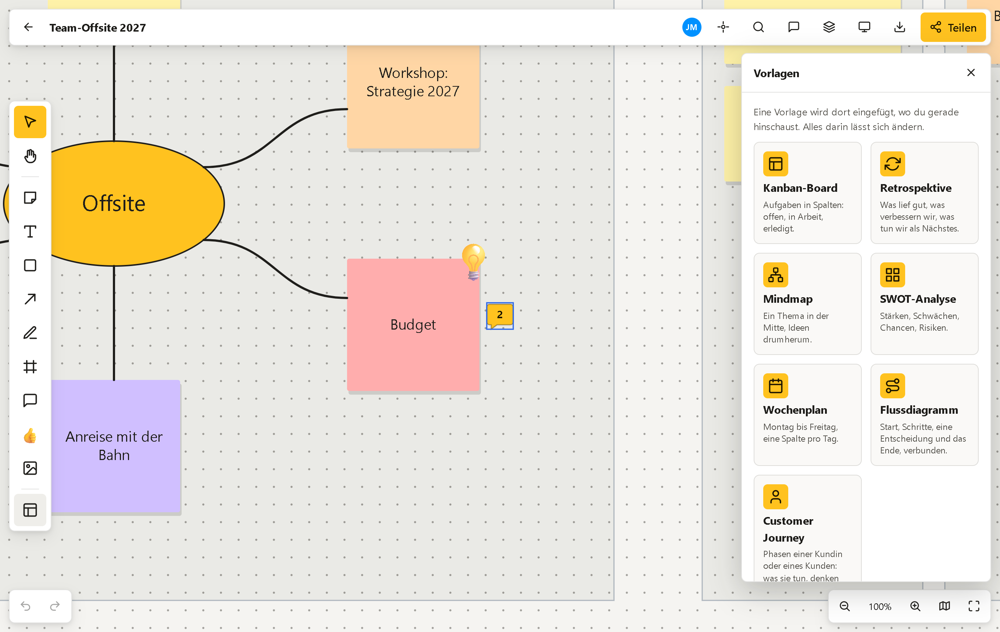 |

| Dunkel, mit der Leiste über der Auswahl | Einer Person folgen |
|---|---|
| 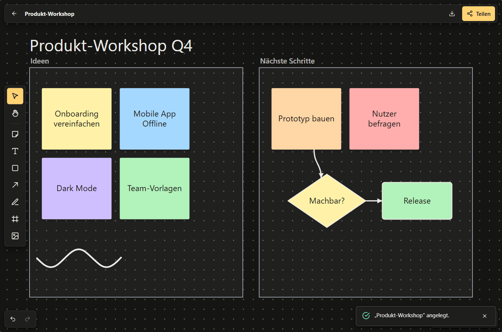 | 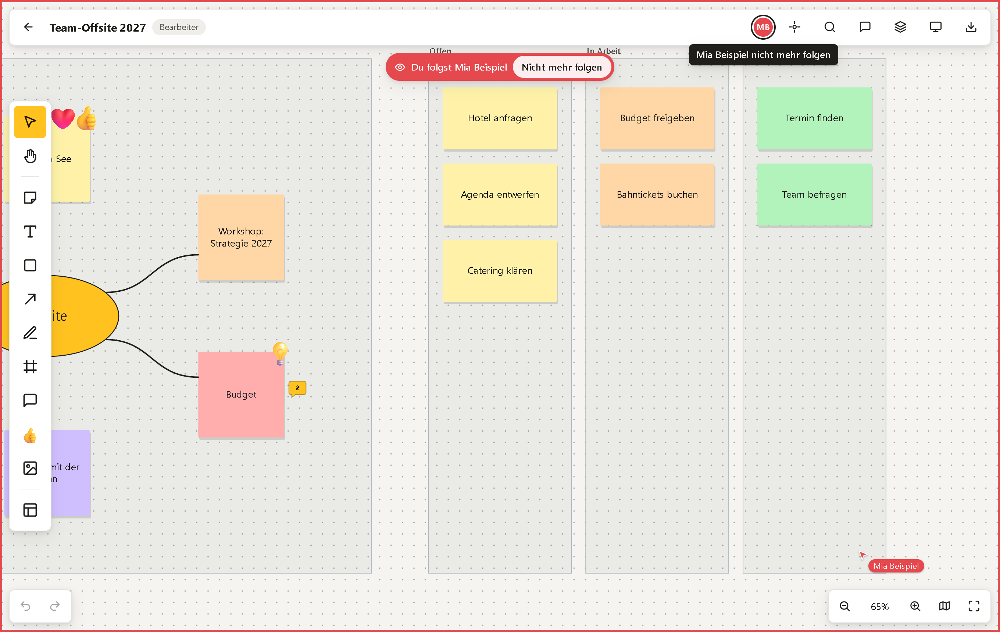 |

| Präsentieren | Boards |
|---|---|
| 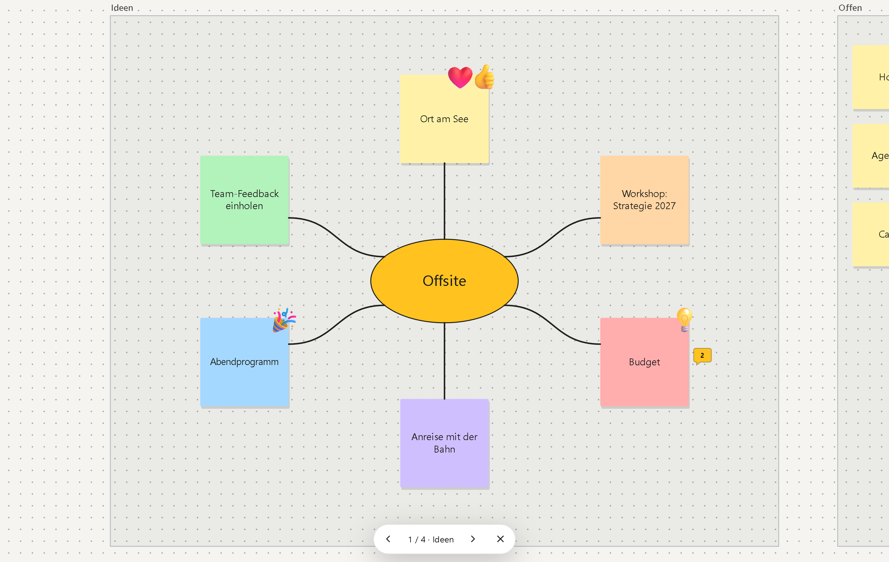 | 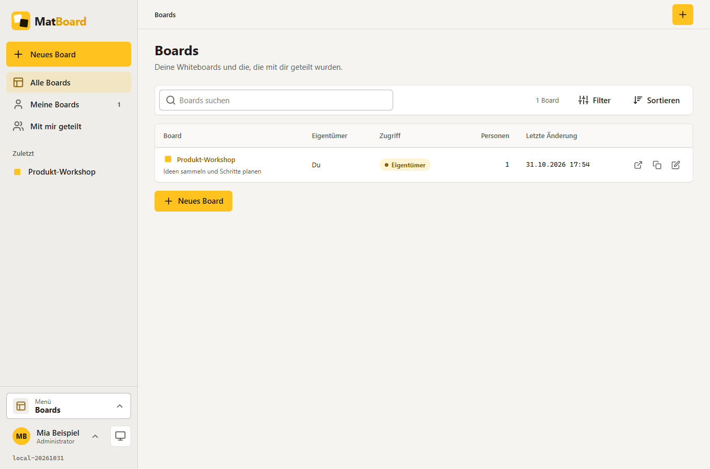 |

| Personen einladen | Per Link teilen |
|---|---|
| 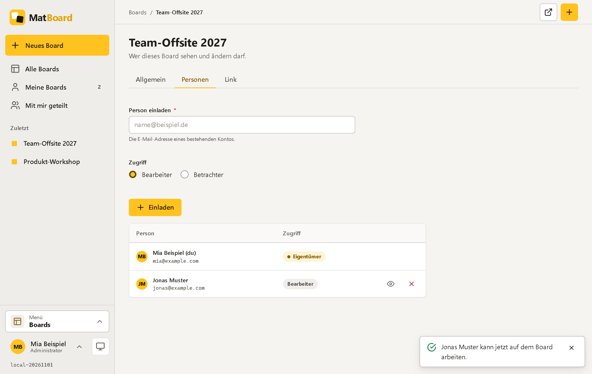 | 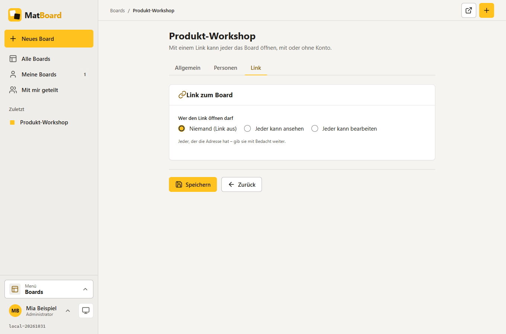 |

| Konto | Benutzer (Administration) |
|---|---|
| 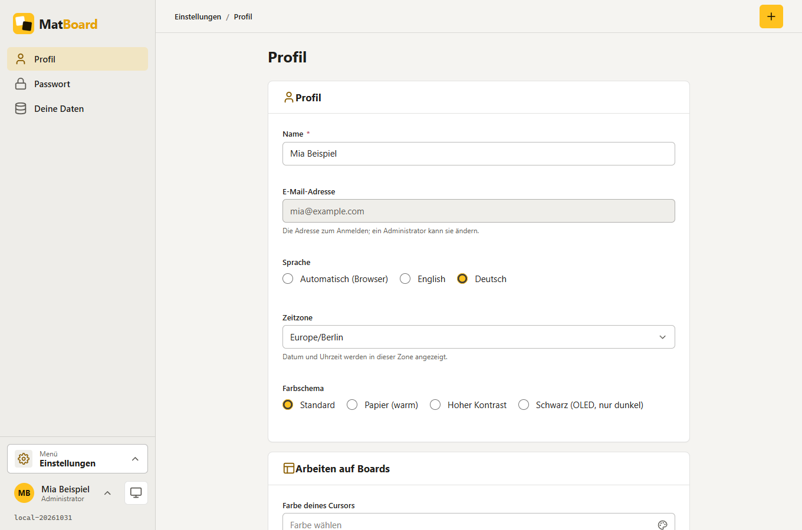 | 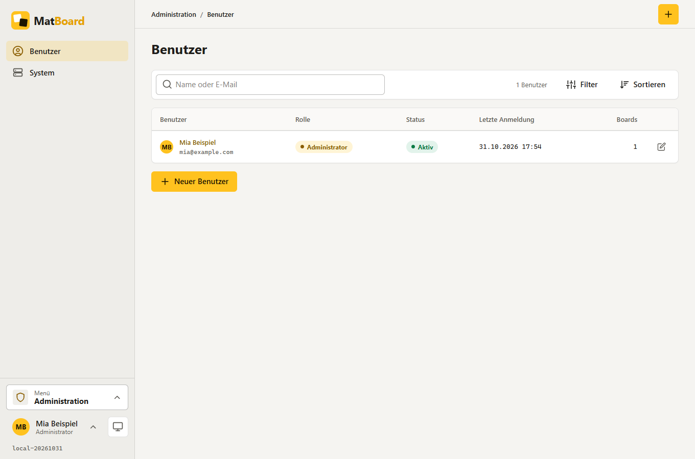 |

| Smartphone | | | |
|---|---|---|---|
| 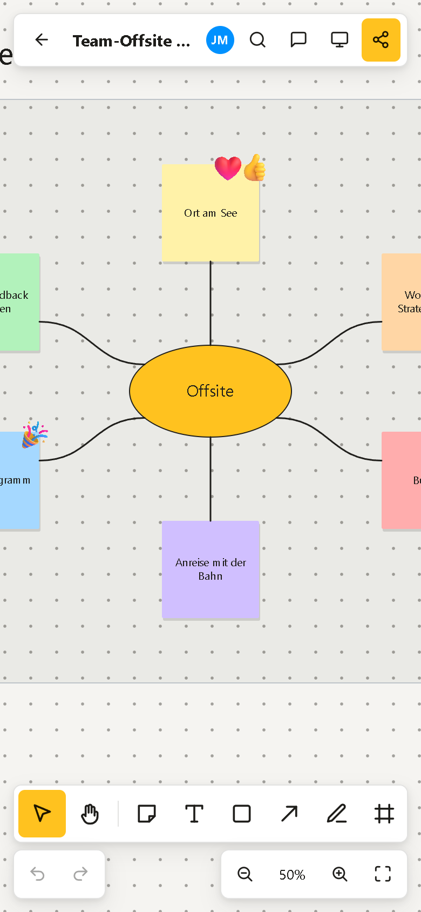 | 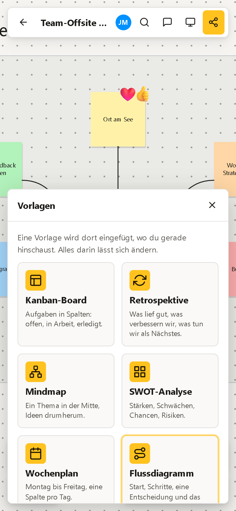 | 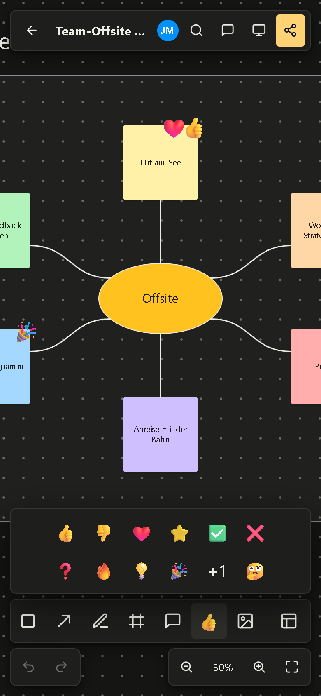 | 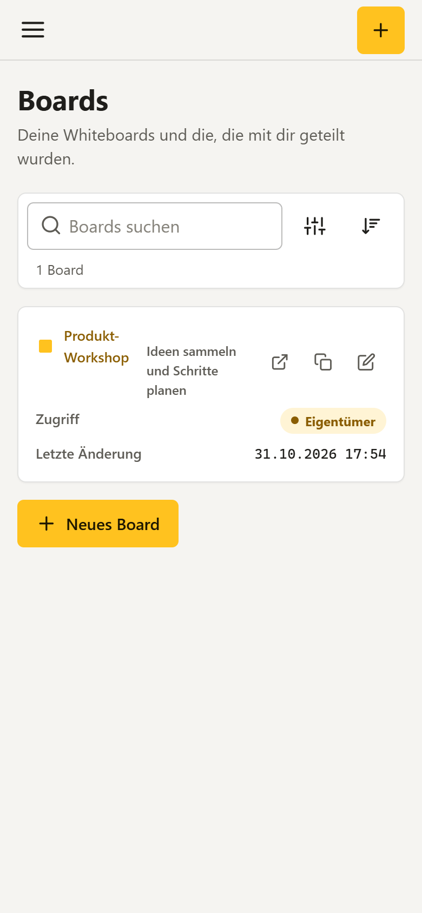 |

## Starten

```bash
docker compose up -d                                       # Release (Branch main, Image :latest)
docker compose -f docker-compose.dev.yml up -d             # Development (Branch dev, Image :nightly) mit pgAdmin auf 3946
docker compose -f docker-compose.local.yml up -d --build   # lokal aus dem Quellcode, mit pgAdmin (3946) und Postgres auf 3947
```

Dann **http://localhost:3945** öffnen und registrieren – das erste Konto ist Administrator. Danach ist die Registrierung **geschlossen**: weitere Konten legt ein Administrator an (*Administration → Benutzer*), oder er öffnet die Registrierung (*Administration → System*).

| Datei | Branch | Image | Dienste |
|---|---|---|---|
| `docker-compose.yml` | main | `ghcr.io/real-ttx/matboard:latest` | web, db |
| `docker-compose.dev.yml` | dev | `ghcr.io/real-ttx/matboard:nightly` | web, db, pgadmin |
| `docker-compose.local.yml` | – | lokal gebaut (`matboard:local`) | web, db, pgadmin |

Volumes je Stack: `web-data` (Schlüssel der Sitzungen) und `db-data` (PostgreSQL 17), bei dev/local zusätzlich `pgadmin-data`. Die Compose-Dateien brauchen **keine** Variablen. Für den Betrieb im Internet das Datenbank-Passwort ändern und einen TLS-Proxy (Caddy, Traefik) davorsetzen – der muss **WebSockets** durchreichen (`/live/boards/{id}/ws`) und `X-Forwarded-Proto` / `X-Forwarded-Host` setzen.

### Einstellungen (Umgebung)

Keine davon ist nötig; ohne sie läuft MatBoard allein mit eigenen Konten und ohne E-Mails. Mattiverse setzt sie, wenn es MatBoard installiert.

| Variable | Bedeutung |
|---|---|
| `ConnectionStrings__Default` | Verbindung zu PostgreSQL (Standard im Image: `Host=db;Database=matboard;Username=matboard;Password=matboard`) |
| `MAT_API_KEY` | Schlüssel für die Plattform-API `/api/*` (Header `X-Api-Key`) |
| `MAT_PUBLIC_URL` | öffentliche Adresse (für geteilte Links und E-Mails); solange sie gesetzt ist, steht sie auf *Administration → System* fest und lässt sich dort und über `/api/configure` nicht ändern – die dort gespeicherte Adresse bleibt und gilt wieder, wenn die Variable wegfällt |
| `MAT_FRAME_ANCESTORS` | Adressen, die MatBoard in einem Frame zeigen dürfen (Mattiverse), durch Leerzeichen getrennt |
| `MATIDENTITY_AUTHORITY`, `MATIDENTITY_CLIENT_ID`, `MATIDENTITY_CLIENT_SECRET`, `MATIDENTITY_INTERNAL_URL` | Anmeldung über MatIdentity |
| `MATSMTP_HOST`, `MATSMTP_PORT`, `MATSMTP_USERNAME`, `MATSMTP_PASSWORD`, `MATSMTP_FROM`, `MATSMTP_TLS` | E-Mails über MatSMTP (z. B. „Ein Board wurde mit dir geteilt“) |

## Plattform (Mattiverse, MatIdentity)

MatBoard erfüllt den Plattform-Vertrag 2 der Mat-Apps ([MatDesign `docs/PLATFORM.md`](https://github.com/Real-TTX/MatDesign/blob/main/docs/PLATFORM.md), das App-Modell in `docs/APP-MODEL.md`; Paket MatPlatform 2.2.1 in `src/MatBoard/MatPlatform`, eine Kopie).

| Endpunkt | Inhalt | Zugriff |
|---|---|---|
| `GET /api` | Beschreibung: Seiten *Übersicht* und *Einstellungen*, Kacheln, Felder, Schaltflächen, Rollen `admin`/`user`, was MatBoard nutzt (`consumes`) und einem Home-Screen hinzufügt (`contributes`) | anonym |
| `GET /api/health` | `ok` / `degraded` (kein aktiver Administrator) / `down` (Datenbank weg) | anonym |
| `GET /api/state[/{key}]` | Kacheln: aktive Benutzer, Boards, geteilte Boards, Boards mit Link, Objekte, geändert in 7 Tagen, Registrierung, letzte Änderung | Schlüssel oder Token |
| `GET`/`PUT /api/configure` | Registrierung offen, öffentliche Adresse (fest, solange `MAT_PUBLIC_URL` gesetzt ist) | Schlüssel oder Token |
| `POST /api/actions/cleanUp` | beendete Sitzungen und vor über 30 Tagen gelöschte Boards endgültig entfernen | Schlüssel oder Token |
| `GET /api/connections` | dasselbe wie die Seite *Verbindungen*, als JSON | Schlüssel oder Token |

**Was MatBoard nutzt** – beides optional, gesetzt durch die Variablen oben: `identity.oidc` (Anmeldung über MatIdentity) und `mail.smtp` (E-Mails über MatSMTP). Eine andere App braucht MatBoard nicht; es bietet selbst nichts an (`provides` ist leer).

**Verbindungen** (*Administration → Verbindungen*, `/Admin/Connections`, nur Administratoren): die Seite, die jede Mat-App hat (`<mat-connections />` aus MatPlatform) – was MatBoard nutzt, ob es durch die Variablen verbunden ist oder nicht (beides ist optional), und was es einem Home-Screen hinzufügt.

**Was MatBoard einem Home-Screen hinzufügt** (Mattiverse zeigt es; ohne Mattiverse kostet es nichts, das Menü der App bleibt der Weg hinein):
- das Symbol **MatBoard** (`/Boards`) mit dem Menü *Neues Board*, *Meine Boards* und *Mit mir geteilt*
- für Administratoren die Widgets **Boards** (Boards, geteilte Boards, Boards mit Link, geändert in 7 Tagen) und **Aktive Benutzer**, gebildet aus den Kacheln von `/api/state`

**Anmeldung über MatIdentity** (nur mit `MATIDENTITY_AUTHORITY`): OpenID Connect mit PKCE, Back-Channel-Logout unter `/signout-backchannel`. Lokale Anmeldung bleibt unter `/Account/Login?local=1` erreichbar.

## Entwicklung

- .NET 10, ASP.NET Core **Razor Pages**, EF Core + **PostgreSQL**, MatUi-Toolkit von MatDesign (kopiert nach `wwwroot/matui`), das Board als SVG mit eigenem JavaScript ohne Build-Schritt (`wwwroot/js/board-*.js`), WebSocket ohne Zusatzbibliothek
- Geschäftslogik in statischen Klassen mit Rechteprüfung in jeder Funktion (`Services/Boards`, `Services/Accounts`); keine Datenbankabfragen in Seiten
- `dotnet build MatBoard.slnx`, `dotnet test` – mit `MATBOARD_TEST_DB` (z. B. `Host=localhost;Port=3947;Username=matboard;Password=matboard;Database=postgres`) laufen auch die Datenbank-Tests, jeder in einer eigenen Datenbank
- `./scripts/redeploy.ps1` baut den Container neu und startet den lokalen Stack (`-Clean` = leere Datenbank)
- Migrationen: `dotnet ef migrations add <Name> -p src/MatBoard -o Data/Migrations` (werden beim Start angewendet)
- Texte: `src/MatBoard/Resources/Texts/*.json` (`{"en": …, "de": …}`); ein Test prüft, dass jeder benutzte Schlüssel in beiden Sprachen existiert
- Mehr zur Architektur in [CLAUDE.md](CLAUDE.md)

### Versionierung und Branches

| Branch | Kanal | Version | Image-Tags |
|---|---|---|---|
| `main` | Release | `0.1.<build>-<datum>` | `<version>`, `latest`, `release` |
| `dev` | Nightly | `nightly-<build>-<datum>` | `<version>`, `nightly` |
| andere / lokal | Local | `local-<datum>` | – |

Major/Minor stehen in `Directory.Build.props`; die GitHub Action `.github/workflows/build.yml` baut, testet und veröffentlicht die Images (amd64 + arm64) nach `ghcr.io/real-ttx/matboard`. Die Version steht unten im Menü und führt zur *Über*-Seite.

## Logo

| Favicon (16–32 px) | App-Icon | Maskable (PWA) | Logo hell | Logo dunkel | Einfarbig |
|---|---|---|---|---|---|
|  |  |  |  |  |  |

Zwei übereinanderliegende Haftnotizen auf dem MatBoard-Gelb **#FFC21F** – nah an Miros Gelb; Schrift darauf ist fast schwarz.
